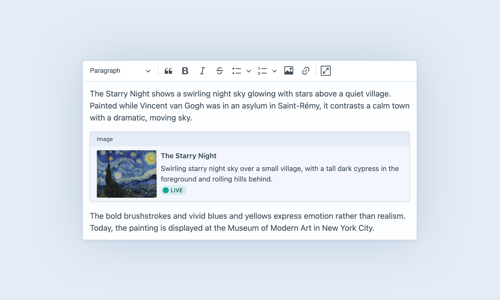
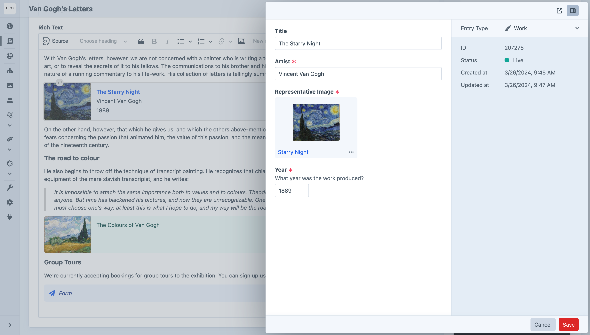

<p align="center"></p>

<h1 align="center">CKEditor</h1>

This plugin adds a “CKEditor” field type to Craft CMS, which provides a deeply-integrated rich text and longform content editor, powered by [CKEditor 5](https://ckeditor.com/).



**Table of Contents:**

- [Requirements](#requirements)
- [Installation](#installation)
- [Configuration](#configuration)
  - [Registering Custom Styles](#registering-custom-styles)
  - [HTML Sanitizing](#html-sanitizing)
  - [Embedding Media](#embedding-media)
  - [License Key](#license-key)
- [Longform Content with Nested Entries](#longform-content-with-nested-entries)
  - [Setup](#setup)
  - [Rendering Nested Entries on the Front End](#rendering-nested-entries-on-the-front-end)
  - [Rendering Chunks](#rendering-chunks)
- [Converting Redactor Fields](#converting-redactor-fields)
- [Converting Matrix Fields](#converting-matrix-fields)
- [Adding CKEditor Plugins](#adding-ckeditor-plugins)
  - [First Party plugins](#first-party-plugins)
  - [Custom plugins](#custom-plugins)
- [Front-end use](#front-end-use)

## Requirements

This plugin requires Craft CMS 6.0 or later, and PHP 8.5 or later. See [UPGRADE.md](UPGRADE.md) for upgrading from Craft 5.

## Installation

You can install this plugin from Craft’s in-app Plugin Store or with Composer.

**From the Plugin Store:**

Go to the Plugin Store in your project’s Control Panel and search for “CKEditor,” then click on the “Install” button in the sidebar.

**With Composer:**

Open your terminal and run the following commands:

```bash
# go to the project directory
cd /path/to/my-project

# tell Composer to load the plugin
composer require craftcms/ckeditor

# tell Craft to install the plugin
php artisan craft:plugin:install ckeditor
```

## Configuration

Each CKEditor field allows you to choose the available toolbar buttons, as well as any custom [config options](https://ckeditor.com/docs/ckeditor5/latest/api/module_core_editor_editorconfig-EditorConfig.html) and CSS styles that should be registered with the field.

Once you have selected which toolbar buttons should be available, additional settings may be applied via **Config options**. Options can be defined as static JSON, or a dynamically-evaluated JavaScript snippet; the latter is used as the body of an [immediately-invoked function expression](https://developer.mozilla.org/en-US/docs/Glossary/IIFE), and does not receive any arguments.

> [!NOTE]  
> Available options can be found in the [CKEditor's documentation](https://ckeditor.com/docs/ckeditor5/latest/api/module_core_editor_editorconfig-EditorConfig.html).

### Examples

#### Table Features

Suppose we wanted to give editors more control over the layout and appearance of in-line tables. Whenever you add the “Insert table” button to an editor, inline controls are exposed for _Table Row_, _Table Column_, and _Merge_. These can be supplemented with _Table Properties_, _Table Cell Properties_, and _Table Caption_ buttons by adding them in the field’s **Config options** section:

```json
{
  "table": {
    "contentToolbar": [
      "tableRow",
      "tableColumn",
      "mergeTableCells",
      "toggleTableCaption",
      "tableProperties",
      "tableCellProperties"
    ]
  }
}
```

Some of these additional buttons can be customized further. For example, to modify the colors available for a cell’s background (within the “[Table Cell Properties](https://ckeditor.com/docs/ckeditor5/latest/api/module_table_tableconfig-TableConfig.html#member-tableCellProperties)” balloon), you would provide an array compatible with the [`TableColorConfig` schema](https://ckeditor.com/docs/ckeditor5/latest/api/module_table_tableconfig-TableColorConfig.html) under `table.tableCellProperties.backgroundColors`.

#### Font Colors

Multiple configuration concerns can coexist in one **Config options** object! You might have a `table` key at the top level to customize table controls (as we've done above), as well as a `fontColor` key that lets you control a pre-defined set of available font colors:

```json
{
  "table": { /* ... */ },
  "fontColor": {
    "colors": [
      {
        "color": "#181818",
        "label": "Black"
      },
      {
        "color": "#d64036",
        "label": "Red"
      },
      {
        "color": "#24b559",
        "label": "Green"
      },
      {
        "color": "#4fa0b0",
        "label": "Blue"
      }
    ]
  }
}
```

#### External Links

You no longer have to use the `link` configuration concern to allow authors to choose whether links should open in new tabs. The manual decorator that added this option can now be made available simply by checking a relevant checkbox under “Advanced Link Fields”.

> [!TIP]  
> An automatic version of this feature is available natively, via the [`link.addTargetToExternalLinks`](https://ckeditor.com/docs/ckeditor5/latest/api/module_link_linkconfig-LinkConfig.html#member-addTargetToExternalLinks) option.


### Registering Custom Styles

CKEditor’s [Styles](https://ckeditor.com/docs/ckeditor5/latest/features/style.html) plugin makes it easy to apply custom styles to your content via CSS classes.

You can define custom styles using the [`style`](https://ckeditor.com/docs/ckeditor5/latest/api/module_core_editor_editorconfig-EditorConfig.html#member-style) config option:

```js
return {
  style: {
    definitions: [
      {
        name: 'Tip',
        element: 'p',
        classes: ['note']
      },
      {
        name: 'Warning',
        element: 'p',
        classes: ['note', 'note--warning']
      },
    ]
  }
}
```

You can then register custom CSS styles that should be applied within the editor when those styles are selected:

```css
.ck.ck-content p.note {
    border-left: 4px solid #4a7cf6;
    padding-left: 1rem;
    color: #4a7cf6;
}

.ck.ck-content p.note--warning {
    border-left-color: #e5422b;
    color: #e5422b;
}
```

### HTML Sanitizing

CKEditor fields pass input through Craft’s HTML sanitizer (built on [`symfony/html-sanitizer`](https://symfony.com/doc/current/html_sanitizer.html)) to avoid saving malicious code to the database. This helps prevent XSS attacks and other vulnerabilities.

Each CKEditor field with **Advanced** &rarr; **Sanitize HTML** enabled uses its selected **HTML Sanitizer**. Other sanitizers can be defined as array config files in `config/craft/sanitizers/` (the file name becomes the sanitizer name), or registered with `CraftCms\Cms\Support\Facades\HtmlSanitizers::extend()`, and are listed in the field’s **HTML Sanitizer** setting:

```php
<?php

// config/craft/sanitizers/no-headings.php
return [
    'allow_safe_elements' => true,
    'block_elements' => ['h1', 'h2'],
];
```

The keys mirror [`HtmlSanitizerConfig`](https://symfony.com/doc/current/html_sanitizer.html)’s methods in snake case (`allow_elements`, `block_elements`, `drop_elements`, `allow_attributes`, `force_attributes`, `allowed_link_schemes`, etc.).

CKEditor extends the selected sanitizer’s config with the markup the field’s toolbar and options need (such as list styles, to-do list checkboxes, `<craft-entry>` tags for nested entries, and link `target` and `rel` attributes when the field’s link options or advanced link fields can add them). Sanitizers registered as instances (e.g. `HtmlSanitizers::extend('name', new HtmlSanitizer(...))`) can’t be extended, so they’re used as-is, and must allow that markup themselves.

> [!WARNING]
> When upgrading from Craft 5, each field’s **Purify HTML** and **HTML Purifier Config** settings are mapped onto **Sanitize HTML** and **HTML Sanitizer** automatically, but `config/craft/htmlpurifier/*.json` files are deprecated, and are only loaded when the Yii 2 adapter is installed. CKEditor doesn’t extend them with the markup the field needs, so any markup they don’t allow—including `<craft-entry>` tags for nested entries—is removed when content is saved. Recreate them as array config files in `config/craft/sanitizers/`, keeping the same file name so fields continue to reference them.

This behavior is independent of CKEditor’s own HTML sanitization engine—the client-side editor automatically strips out any markup that isn’t supported by an enabled feature or plugin. If you [install additional plugins](#adding-ckeditor-plugins) or add [custom styles](#registering-custom-styles), you may need to relax the sanitizer config to ensure the markup is not removed by the server when saved.

> [!WARNING]
> _Disabling HTML sanitizing entirely can expose your site to significant security risks, even if you don’t accept input from anonymous users._  
> The sanitizer provides a layer of security, while CKEditor is primarily concerned with hygiene.

The sanitizer config used by CKEditor fields can be modified with the `CraftCms\Ckeditor\Events\HtmlSanitizerConfigResolving` event, which is dispatched after CKEditor has extended it. The event isn’t dispatched for sanitizers registered as instances (including legacy `config/craft/htmlpurifier/*.json` files). `HtmlSanitizerConfig` is immutable, so assign the modified config back to the event:

```php
use CraftCms\Ckeditor\Events\HtmlSanitizerConfigResolving;
use Illuminate\Support\Facades\Event;

Event::listen(function(HtmlSanitizerConfigResolving $event): void {
    // $event->field is the CKEditor field
    $event->config = $event->config->allowElement('abbr', ['title']);
});
```

CKEditor also makes its [general HTML support](https://ckeditor.com/docs/ckeditor5/latest/features/html/general-html-support.html) rules configurable, for situations where the source editor is used, or when authors expect some formatting from pasted content to be preserved:

```js
return {
  // ...
  htmlSupport: {
    allow: [
      {
        name: 'abbr',
        attributes: ['title'],
        classes: false,
        styles: false
      }
    ],
    disallow: [
      // ...
    ],
  },
};
```

Adding a rule to the `disallow` array does not guarantee that matching HTML is stripped from the markup! CKEditor always ensures that the editor’s enabled features and plugins continue to work—for example, disabling all `style` attributes in an editor that supports lists will still permit `style="list-style-type: upper-roman;"`.

### Embedding Media

CKEditor 5 stores references to embedded media embeds using `oembed` tags. Craft’s default HTML sanitizer allows these tags (and `<div data-oembed-url>` tags), but removes `<iframe>` tags. If your fields contain `<iframe>` embeds, allow them with the [`HtmlSanitizerConfigResolving` event](#html-sanitizing).

To automatically replace `oembed` tags with the media provider’s embed HTML, enable the field’s **Parse embeds** setting. Alternatively, see CKEditor’s [media embed documentation](https://ckeditor.com/docs/ckeditor5/latest/features/media-embed.html#displaying-embedded-media-on-your-website) for examples of how to show the embedded media on your front end.

> [!NOTE]
> Be sure to cache your front-end output if you enable the “Parse embeds” setting (e.g. by using a `` tag). Otherwise, there will be a slight performance hit on each request while CKEditor fetches the embed HTML from the provider.

### License Key

CKEditor is used under the GPL license by default, which displays a “Powered by CKEditor” badge within each editor. If you have a [commercial CKEditor license](https://ckeditor.com/pricing/), you can enter its key in **Settings** → **Plugins** → **CKEditor** → **License Key**. The key can be set to an environment variable (e.g. `$CKEDITOR_LICENSE_KEY`).

You can also set it from `config/craft/ckeditor.php`:

```php
<?php

return [
    'licenseKey' => env('CKEDITOR_LICENSE_KEY'),
];
```

Individual fields can override the key via a `licenseKey` property in their **Config options**.

## Longform Content with Nested Entries

CKEditor fields can be configured to manage nested entries, which will be displayed as [cards](https://craftcms.com/docs/5.x/system/elements.html#chips-cards) within your rich text content, and edited via [slideouts](https://craftcms.com/docs/5.x/system/control-panel.html#slideouts).



Nested entries can be created anywhere within your content, and they can be moved, copied, and deleted, just like images and embedded media.

### Setup

To configure a CKEditor field to manage nested entries, follow these steps:

1. Go to **Settings** → **Fields** and click on the field you wish to edit (or create a new one).
2. Drag the “+” menu button into the toolbar.
3. Select one or more entry types which should be available within the field.
4. And save.

Now the field is set up to manage nested entries! The next time you edit an element with that CKEditor field, the “+” button will be shown in the toolbar, and when you choose an entry type from its menu, a slideout will open where you can enter content for the nested entry.

An entry card will appear within the rich text content after you press **Save** within the slideout. The card can be moved via drag-n-drop or cut/paste from there.

> [!TIP]
> You can choose which entry types should show as individual toolbar buttons and which should be nested under the “+” button. The ones selected to show as individual buttons will be displayed as an icon if the entry type is configured to have one and as text if no icon is specified. Use the 3-dots (actions) menu to toggle this behavior.

You can also copy/paste the card to duplicate the nested entry.

To delete the nested entry, simply select it and press the **Delete** key.

> [!NOTE]  
> Copy/pasting entry cards across separate CKEditor fields is supported, providing both fields allow the entry type of the copied nested entry.

### Rendering Nested Entries on the Front End

On the front end, nested entries will be rendered automatically via their [partial templates](https://craftcms.com/docs/5.x/system/elements.html#rendering-elements).

For each entry type selected by your CKEditor field, create a `_partials/entry/<entryTypeHandle>.twig` file within your `templates/` folder, and place your template code for the entry type within it.

An `entry` variable will be available to the template, which references the entry being rendered.

> [!TIP]
> If your nested entries contain any relational fields, you can eager-load the related elements using [`eagerly()`](https://craftcms.com/docs/5.x/development/eager-loading.html#lazy-eager-loading).
> 
> ```twig
> {# Within an element partial... #}
> 
>   {# ... #}
> 
> ```

### Rendering Chunks

CKEditor field content is represented by an object that can be output as a string (`{{ entry.myCkeditorField }}`), or used like an array:

```twig

  <div class="chunk {{ chunk.type }}">
    {{ chunk }}
  </div>

```

“Chunks” have two `type`s: `markup`, containing CKEditor HTML; and `entry`, representing a single nested entry. Adjacent `markup` chunks are collapsed into one another in cases where an intervening nested entry is disabled.

The example above treats both chunk types as strings. For entry chunks, this is equivalent to calling `{{ entry.render() }}`. If you would like to customize the data passed to the element partial, or use a different representation of the entry entirely, you have access to the nested entry via `chunk.entry`:

```twig

  
    <div class="chunk markup">
      {{ chunk }}
    </div>
  
    <div class="chunk entry" data-entry-id="{{ chunk.entry.id }}">
      {# Call the render() method with custom params... #}
      {{ chunk.entry.render({
        isRss: true,
      }) }}

      {# ...or provide completely custom HTML for each supported entry type! #}
      
        
          
          
            <figure>
              {# ... #}
            </figure>
        
          

          <a href="{{ doc.url }}" download>Download {{ doc.filename }}</a> ({{ doc.size|filesize }})
        
          {# For anything else: #}
          {{ chunk.entry.render() }}
      
    </div>
  

```

## Converting Redactor Fields

You can use the `ckeditor:convert:redactor` command to convert any existing Redactor fields over to CKEditor.

The command will make changes to your project config. You should commit them, and run `php artisan craft:migrate:all` on other environments for the changes to take effect.

```sh
php artisan ckeditor:convert:redactor
```

## Converting Matrix Fields

You can use the `ckeditor:convert:matrix` command to convert a Matrix field over to CKEditor. Each of the Matrix field’s entry types will be assigned to the CKEditor field, and field values will be a mix of HTML content extracted from one of the nested entry types of your choosing (if desired) combined with nested entries.

```sh
php artisan ckeditor:convert:matrix <myMatrixFieldHandle>
```

The command will generate a new content migration in `database/migrations/`, which will need to be run on other environments (via `php artisan craft:migrate:all`) in order to update existing elements’ field values.

## Adding CKEditor Plugins

### First Party plugins
If you'd like to include any of the [first party packages](https://github.com/ckeditor/ckeditor5/tree/master/packages) from CKEditor not [already included](src/Support/CkeditorConfig.php), you can call `CkeditorConfig::registerFirstPartyPackage()` from a service provider’s `boot()` method (e.g. your project’s `AppServiceProvider`).

```php
use CraftCms\Ckeditor\Support\CkeditorConfig;

public function boot(): void
{
    // Register a package with toolbar items and multiple plugins
    CkeditorConfig::registerFirstPartyPackage(['SpecialCharacters', 'SpecialCharactersEssentials'], ['specialCharacters']);

    // Register a package with a single plugin.
    CkeditorConfig::registerFirstPartyPackage(['ImageResize']);
}
```

### Custom plugins
- If you’re creating a custom CKEditor plugin, use [CKEditor’s package generator](https://ckeditor.com/docs/ckeditor5/latest/framework/plugins/package-generator/using-package-generator.html) to scaffold it.

> [!TIP]  
> Check out CKEditor’s [Creating a basic plugin](https://ckeditor.com/docs/ckeditor5/latest/framework/tutorials/creating-simple-plugin-timestamp.html) tutorial for an in-depth look at how to create a custom CKEditor plugin.

Once the CKEditor package is built, publish its files from your plugin (e.g. with the plugin’s `$publishables` property), and register it with `CraftCms\Ckeditor\Support\CkeditorAssets::registerPackage()` from your plugin’s `boot()` method. A `CkeditorPackage` defines the package’s namespace, the URL of its entry file, the CKEditor plugin names it provides, and any toolbar items that should be made available via the plugin.

For example, here’s how a plugin would register a “Tokens” package:

```php
use CraftCms\Ckeditor\Data\CkeditorPackage;
use CraftCms\Ckeditor\Support\CkeditorAssets;

protected array $publishables = [
    __DIR__ . '/../resources/tokens' => 'tokens',
];

public function boot(CkeditorAssets $ckeditorAssets): void
{
    $ckeditorAssets->registerPackage(new CkeditorPackage(
        namespace: '@craftcms/ckeditor5-tokens',
        url: $this->asset('tokens/tokens.js'),
        pluginNames: ['Tokens'],
        toolbarItems: ['tokens'],
        // optional:
        styles: [$this->asset('tokens/tokens.css')],
        translationsPath: __DIR__ . '/../resources/tokens/translations',
        translationsUrl: $this->asset('tokens/translations'),
    ));
}
```

It doesn’t matter which order plugins are loaded in.

Each CKEditor field only imports your package and registers its files if one of the package’s `toolbarItems` is in the field’s toolbar. Packages without toolbar items aren’t tied to the toolbar:

- If `toolbarItems` is empty, the package’s plugins are loaded for every field.
- If `pluginNames` is empty too, the package’s entry file is registered for every field, and its JavaScript runs for its side effects.

If some of your plugins go with a toolbar button and others should always be loaded, register the always-on plugins separately:

```php
// Plugins in pluginNames only load when one of toolbarItems is in the toolbar
$ckeditorAssets->registerPackage($package);

// These load for every field
\CraftCms\Ckeditor\Support\CkeditorConfig::registerPackage($package->namespace, [
    'plugins' => ['TokensAutocomplete'],
]);
```

Plugins from your package are referenced through a namespace import (`import * as pkg from '@craftcms/ckeditor5-tokens'`), so their names won’t collide with plugins from other packages. A field’s custom config JS can still refer to your plugin class by name, e.g. `extraPlugins: [Tokens]` to enable it without its toolbar button. The package is imported for that field whenever its config mentions the plugin, as long as no other package provides a plugin with the same name.

If you need your package’s files on a page that creates its own CKEditor instances, call `CkeditorAssets::registerPackageAssets()`.

## Front-end use

If you wish to use CKEditor on the front end, the safest option is to [bring your own CKE build](https://ckeditor.com/docs/ckeditor5/latest/getting-started/installation/self-hosted/quick-start.html). Craft’s bundle (while technically allowed under the GPL3 license) is not suitable for front-end use, due to its control panel-dependent functionality. Simple [configurations](#configuration) defined via the control panel _can_ be used piecemeal in your initializer:

```twig
{# Load from the CDN, or a custom bundle... #}
<link rel="stylesheet" href="https://cdn.ckeditor.com/ckeditor5/44.3.0/ckeditor5.css" />
<script src="https://cdn.ckeditor.com/ckeditor5/44.3.0/ckeditor5.umd.js"></script>

{# Load the field definition via the field and CKEditor APIs: #}


<div id="editor">
    {{ entry.myCkEditorField }}
</div>

<script>
    // Select any required plugins from the distribution:
    const {
        ClassicEditor,
        Essentials,
        Bold,
        Italic,
        Font,
        Paragraph
    } = CKEDITOR;

    ClassicEditor
        .create(document.querySelector('#editor'), {
            licenseKey: '<YOUR_LICENSE_KEY>',
            plugins: [Essentials, Bold, Italic, Font, Paragraph],
            // Configure dynamically from settings:
            toolbar: {{ field.toolbar|json_encode|raw }},
        })
        .then()
        .catch();
</script>
```

You may need to build up the top-level config object from `field.options`, `field.headingLevels`, and so on to get a complete, functional editor—be mindful that configurations may rely on plugins that are only available in the control panel! Refer to [`CraftCms\Ckeditor\Field::uiControl()`](src/Field.php) for additional steps the CKEditor plugin when normalizing configuration, for control panel editor instances.
